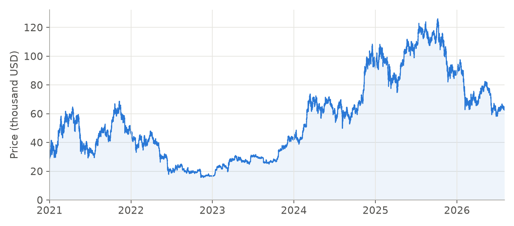
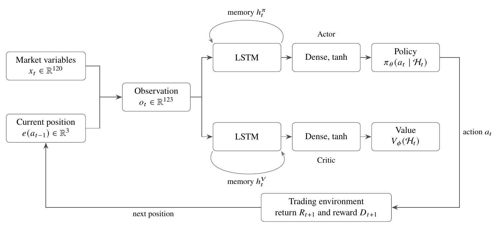
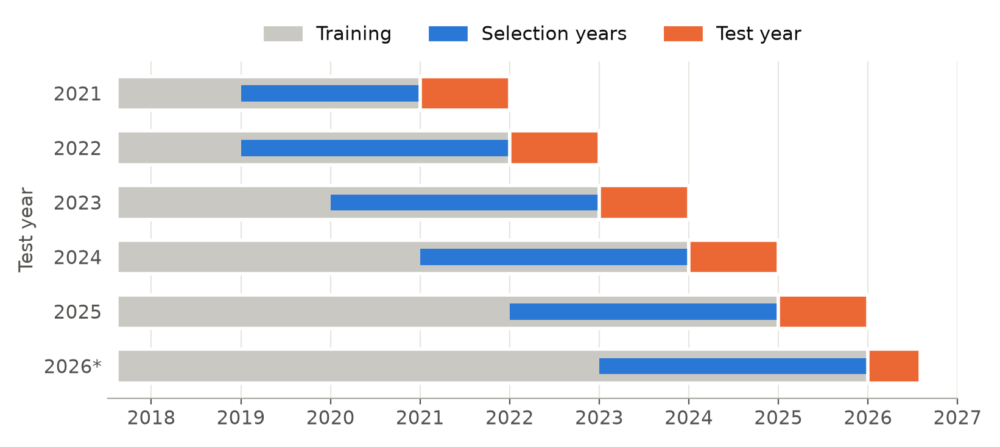
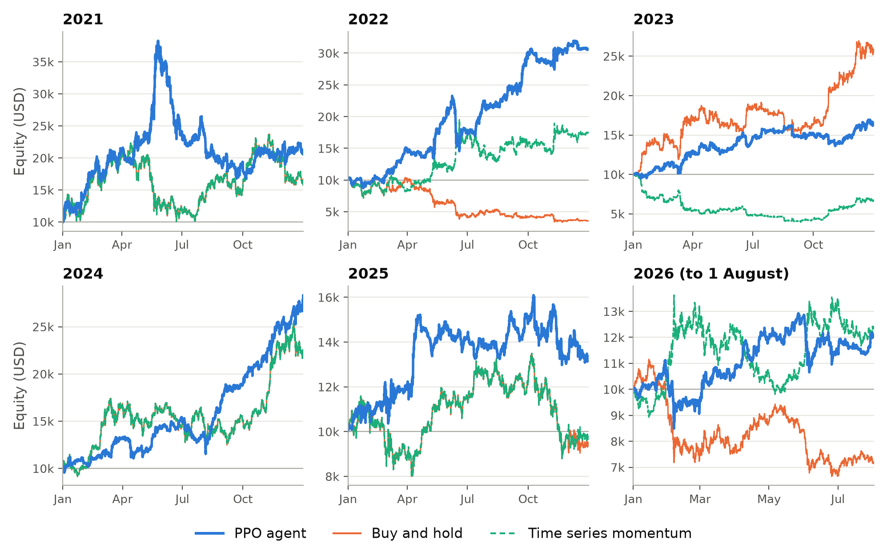

**Project description**
- *Author:* Elvin Zeynalli, Sabanci Business School
- *Language:* Python
- *Libraries:* PyTorch, numpy, pandas
- *Project type:* Deep reinforcement learning, optimal trading
- *Data source:* BitMEX XBTUSD hourly prices, volume, and funding, 2017 to 2026

---

Financial markets are nonstationary, and patterns that forecast returns in one period rarely persist into the next. Markets nevertheless pass through recognizable conditions that last for some time. This suggests that a trading agent can succeed by recognizing and adapting to the prevailing condition rather than by predicting prices.

This post presents a study that puts the idea to a test on Bitcoin perpetual futures. A recurrent agent, trained with proximal policy optimization (PPO), chooses a short, flat, or long position every hour and is rewarded for improving its risk adjusted performance. It is retrained every year on the data available at the time and evaluated on the following year, over five and a half years that include strong advances, a deep decline, and a record high followed by a sharp fall.

The question is whether a reinforcement learning (RL) agent can generalize across changing market conditions on data it has not seen. Averaged over ten random initializations, the agent reached an annualized Sharpe ratio of 1.39, compared with 0.53 for buy and hold and 0.78 for time series momentum, the strongest benchmark, and it remained profitable in every calendar year.

## Table of contents

## Why Learn the Decision Directly

Quantitative trading has traditionally relied on statistical models of prices or on forecasts that are translated into positions through an additional rule. Both approaches separate the description of the market from the trading decision. A trade, however, is a sequence of decisions whose consequences unfold over time, and a forecast that is accurate over one horizon does not by itself determine whether a position should be opened, held, or closed.

RL removes this separation, because the trading objective itself becomes the target of learning. This line of work goes back to Moody and Saffell [1], who trained recurrent trading systems directly against risk adjusted objectives, and it was later extended with deep networks by Deng et al. [2], Zhang, Zohren and Roberts [3], and Jiang et al. [4].

When prices reflect available information, as Fama argued [5], predictable patterns are small and tend to disappear once exploited. Yet markets pass through periods of steady advance, turbulent decline, and movement without a clear direction, and each condition tends to persist for a while [6]. An agent should therefore learn to recognize the prevailing condition, hold an exposure that suits it, and adjust when the condition changes. The paper refers to this ability as trading instinct.

Bitcoin perpetual futures make this problem particularly demanding. These contracts trade continuously, allow long and short positions without an expiry date, and rely on periodic funding payments to keep their price close to the underlying asset [7]. Studies of RL on these contracts remain few. Borrageiro et al. [8] let the policy keep learning during evaluation, whereas Chun et al. [9] use a single test period. Neither design shows whether annual retraining, followed by evaluation with fixed parameters, produces consistent results across several years.

## Problem Definition

The problem is single asset optimal trading of Bitcoin perpetual futures. The account equity is measured in US dollars and changes in direct proportion to the price return and the chosen exposure, while a flat position holds no exposure. The market is assumed to be frictionless, so positions are opened and closed at the hourly closing price. This isolates the central question of the study, namely whether the agent can learn a profitable sequence of trading decisions across changing market conditions. All benchmarks are evaluated under the same assumption.

## Data

Hourly bars were built from the official BitMEX public trade archive for XBTUSD, together with all realized funding settlements. Every variable computed at time $t$ uses only information available at that time. The usable sample contains 78,637 hourly observations from 12 August 2017 to 1 August 2026, and the test period begins on 1 January 2021.

*Figure 1: Hourly XBTUSD closing price over the test period.*

The market changed direction repeatedly and by large amounts. The price rose by 59.6 percent in 2021, fell by 64.2 percent in 2022, and more than doubled in both 2023 and 2024. It reached an all time high of 126,036 USD in October 2025 and then fell by 28.3 percent in the first seven months of 2026. Below, 2026* denotes this partial year.

## The Markov Decision Process

The trading problem is formulated as a Markov decision process (MDP). Because a finite set of market variables describes the market only partially, the agent acts on the history of observations $\mathcal{H}_t = (o_1, \dots, o_t)$, which it summarizes with recurrent memory.

### State

Bitcoin prices, volatility, and volume changed by large factors between 2017 and 2026, so every market variable is expressed relative to its own history, as a ratio, as a movement in units of recent volatility, or as a percentile rank within a trailing window. The observation combines 120 such variables with the current position. They cover recent returns, momentum, volatility, volume, the position of the price within its recent range, trend efficiency and persistence, and funding, at scales from one hour to one year.

### Actions

At every hour the agent chooses a target position $a_t \in \{-1, 0, 1\}$, corresponding to a short, flat, or long exposure equal to the equity of the account, and holds it for one hour. The return of the account is

$$
R_{t+1}=a_t\left(\frac{P_{t+1}}{P_t}-1\right),
$$

so a long position earns the percentage change of the price, a short position earns its negative, and a flat position earns nothing.

### Reward

The reward favours returns that are high relative to their variability rather than profit alone. It is the differential Sharpe ratio of Moody et al. [10], which measures the contribution of the latest return to an exponentially weighted Sharpe ratio of the account. With $A_t$ and $B_t$ the exponentially weighted mean and mean square of recent returns, $\Delta A_t=R_t-A_{t-1}$, and $\Delta B_t=R_t^2-B_{t-1}$, the reward is

$$
D_t=\frac{B_{t-1}\Delta A_t-\tfrac12 A_{t-1}\Delta B_t}
{\left(B_{t-1}-A_{t-1}^{2}\right)^{3/2}}.
$$

It is positive when the latest return improves the risk adjusted performance of the account and negative when it lowers it. The agent maximizes the discounted sum of these rewards with $\gamma=0.98$, which gives an effective horizon of about 50 hours.

## Agent Architecture

The agent has separate networks for the policy and the value function. The actor assigns probabilities to the three positions, and the critic estimates the discounted rewards expected from the current observation history. Each network processes the observation with a long short term memory (LSTM) layer [11], followed by a fully connected layer and a linear output layer, and its recurrent memory is carried from one hour to the next.

*Figure 2: Architecture of the recurrent actor and critic.*

## Learning Algorithm

PPO, introduced by Schulman et al. [12], alternates between collecting experience with the current policy and updating both networks from that experience. The quality of an action is measured by its advantage $\widetilde A_t$, the amount by which its outcome exceeded what the critic expected. The actor maximizes the clipped objective with an entropy bonus,

$$
J(\theta)=\frac{1}{|\mathcal B|}\sum_{t\in\mathcal B}
\left[\min\{\rho_t\widetilde A_t,\,
\operatorname{clip}(\rho_t,1-\epsilon,1+\epsilon)\widetilde A_t\}
+c_H H\big(\pi_\theta(\cdot\mid\mathcal H_t)\big)\right],
$$

where $\rho_t$ is the ratio between the probabilities of the chosen action under the updated policy and under the policy that collected the data. The clipping with $\epsilon=0.2$ removes the incentive to change the probability of an action by more than about 20 percent on the basis of a single sample, and the entropy bonus encourages the agent to try different actions during training. The critic minimizes the squared error of its value estimates.

The training data are presented as one continuous path. Eight copies of the environment traverse it from evenly spaced starting points, so every update combines experience from different market conditions. Because the outcome of a single run can vary considerably with the random initialization, as Henderson et al. show [13], ten agents are trained from different initializations, and the reported PPO agent is the average of their separately evaluated results.

## Walk Forward Evaluation

The agent is evaluated with an expanding walk forward design, in the form used by Gu, Kelly and Xiu [14]. Each calendar year from 2021 to 2026 is a test year. Before each test year, the settings of the agent are chosen using only the preceding years, the agent is trained on all data up to the end of the previous year, and its parameters remain fixed while it trades. Each test year then becomes part of the training data for the following years.

*Figure 3: Expanding walk forward design.*

Sixteen candidate configurations of the actor learning rate, network width, entropy coefficient, and reward adaptation rate are compared, and the one standard error rule of Hastie et al. [15] sets the number of training passes and favours configurations that perform consistently across years. The choices were stable, and the rule shortened training in every year.

The benchmarks are buy and hold, the 50 day and 200 day moving average rules [16], time series momentum [17], the moving average convergence divergence (MACD) rule [18], the relative strength index (RSI) rule [19], and a random policy, evaluated on the same hours and under the same accounting.

## Results

### Performance over the Test Period

The table summarizes performance from January 2021 to August 2026. CAGR is the compounded annual growth rate, and the Sharpe ratio is annualized with a zero risk free rate.

| Strategy | CAGR (%) | Sharpe | Max. drawdown (%) |
|---|--:|--:|--:|
| **PPO agent** | **89.7** | **1.39** | **64.6** |
| Buy and hold | 14.8 | 0.53 | 77.3 |
| 50 day moving average | 28.6 | 0.72 | 64.9 |
| 200 day moving average | 1.8 | 0.33 | 87.3 |
| Time series momentum | 33.5 | 0.78 | 64.4 |
| MACD | −5.0 | 0.21 | 66.3 |
| RSI | −16.2 | −0.50 | 66.4 |
| Random policy (median) | −10.9 | 0.00 | 79.9 |

The PPO agent outperformed every benchmark in growth and on a risk adjusted basis. Its maximum drawdown was smaller than that of buy and hold and similar to those of the 50 day moving average and time series momentum rules, so its higher growth was not obtained at the cost of larger losses than those of the strongest benchmarks. All ten individual agents achieved Sharpe ratios between 1.06 and 1.63, above that of every benchmark.

The agent traded actively and in both directions. It held a long position in 54.4 percent of the hours, a short position in 38.8 percent, and a flat position in the remaining 6.9 percent, and it changed its position about 4.2 times per day.

### Performance across Market Conditions

In the figure, the equity of every strategy is rebased to 10,000 USD at the start of each year, and only buy and hold and time series momentum are drawn. Time series momentum stayed long throughout 2021 and 2024, so its dashed line coincides with buy and hold in those years. The tables below report every strategy.

*Figure 4: Equity by calendar year, rebased to 10,000 USD at the start of every year.*

| Return (%) | 2021 | 2022 | 2023 | 2024 | 2025 | 2026* |
|---|--:|--:|--:|--:|--:|--:|
| **PPO agent** | 107.9 | **207.0** | 63.2 | **181.8** | **33.6** | 20.9 |
| Buy and hold | 59.6 | −64.2 | **156.1** | 120.7 | −6.3 | −28.3 |
| 50 day moving average | **131.3** | −48.6 | 118.9 | 31.2 | 7.5 | 11.1 |
| 200 day moving average | −67.1 | 85.1 | 45.3 | 41.6 | −28.9 | 24.0 |
| Time series momentum | 59.6 | 75.1 | −33.0 | 120.7 | −1.8 | 24.0 |
| MACD | −17.9 | −13.2 | 12.0 | 5.8 | −36.7 | **40.8** |
| RSI | −23.5 | 19.3 | −27.0 | −35.2 | −2.4 | −11.2 |

| Sharpe ratio | 2021 | 2022 | 2023 | 2024 | 2025 | 2026* |
|---|--:|--:|--:|--:|--:|--:|
| **PPO agent** | 1.19 | **1.90** | 1.35 | **2.14** | **0.87** | 0.94 |
| Buy and hold | 0.97 | −1.28 | **2.39** | 1.75 | 0.08 | −1.04 |
| 50 day moving average | **1.40** | −0.71 | 2.03 | 0.78 | 0.39 | 0.62 |
| 200 day moving average | −0.84 | 1.28 | 1.08 | 0.92 | −0.54 | 1.04 |
| Time series momentum | 0.97 | 1.19 | −0.71 | 1.75 | 0.18 | 1.04 |
| MACD | 0.21 | 0.10 | 0.48 | 0.37 | −0.80 | **1.53** |
| RSI | −0.45 | 0.71 | −1.21 | −1.74 | −0.11 | −0.87 |

The PPO agent was profitable in all six years, both when the price rose and when it fell. In 2022, when buy and hold lost 64.2 percent, the agent gained 207.0 percent. In 2025 and the first seven months of 2026, when the price fell by 6.3 and 28.3 percent, it gained 33.6 and 20.9 percent. It trailed buy and hold in 2023, the year of the strongest and least volatile advance, when it gained 63.2 percent against 156.1 percent. Across the 60 combinations of the ten agents and the six years, 59 were profitable. The sole loss was 7.4 percent for one run in 2021.

The benchmarks depended on the conditions they encountered. Buy and hold and the 50 day moving average rule gained strongly in 2023 but lost heavily in 2022. Time series momentum profited from the decline of 2022 but lost in 2023, when the direction of the market reversed. Every benchmark lost money in at least one year, and none had a positive Sharpe ratio in every year, whereas the Sharpe ratio of the PPO agent was positive in all six. The agent did not need to be the best strategy in every year to outperform over the complete period. What distinguishes it is that it remained profitable as the market moved from one condition to another.

## References

\[1\] Moody, J., & Saffell, M. (2001). Learning to trade via direct reinforcement. *IEEE Transactions on Neural Networks*, 12(4), 875–889. https://doi.org/10.1109/72.935097

\[2\] Deng, Y., Bao, F., Kong, Y., Ren, Z., & Dai, Q. (2017). Deep direct reinforcement learning for financial signal representation and trading. *IEEE Transactions on Neural Networks and Learning Systems*, 28(3), 653–664. https://doi.org/10.1109/TNNLS.2016.2522401

\[3\] Zhang, Z., Zohren, S., & Roberts, S. (2020). Deep reinforcement learning for trading. *The Journal of Financial Data Science*, 2(2), 25–40. https://doi.org/10.3905/jfds.2020.1.030

\[4\] Jiang, Z., Xu, D., & Liang, J. (2017). A deep reinforcement learning framework for the financial portfolio management problem. arXiv preprint. https://doi.org/10.48550/arXiv.1706.10059

\[5\] Fama, E. F. (1970). Efficient capital markets: A review of theory and empirical work. *The Journal of Finance*, 25(2), 383–417. https://doi.org/10.2307/2325486

\[6\] Ang, A., & Timmermann, A. (2012). Regime changes and financial markets. *Annual Review of Financial Economics*, 4, 313–337. https://doi.org/10.1146/annurev-financial-110311-101808

\[7\] He, S., Manela, A., Ross, O., & von Wachter, V. (2022). Fundamentals of perpetual futures. arXiv preprint. https://arxiv.org/abs/2212.06888

\[8\] Borrageiro, G., Firoozye, N., & Barucca, P. (2022). The recurrent reinforcement learning crypto agent. *IEEE Access*, 10, 38590–38599. https://doi.org/10.1109/ACCESS.2022.3166599

\[9\] Chun, J. H., & Lee, S. J. (2025). Cryptocurrency futures portfolio trading system using reinforcement learning. *Applied Sciences*, 15(17), 9400. https://doi.org/10.3390/app15179400

\[10\] Moody, J., Wu, L., Liao, Y., & Saffell, M. (1998). Performance functions and reinforcement learning for trading systems and portfolios. *Journal of Forecasting*, 17(5–6), 441–470.

\[11\] Hochreiter, S., & Schmidhuber, J. (1997). Long short-term memory. *Neural Computation*, 9(8), 1735–1780. https://doi.org/10.1162/neco.1997.9.8.1735

\[12\] Schulman, J., Wolski, F., Dhariwal, P., Radford, A., & Klimov, O. (2017). Proximal policy optimization algorithms. arXiv preprint. https://doi.org/10.48550/arXiv.1707.06347

\[13\] Henderson, P., Islam, R., Bachman, P., Pineau, J., Precup, D., & Meger, D. (2018). Deep reinforcement learning that matters. *Proceedings of the Thirty Second AAAI Conference on Artificial Intelligence*, 3207–3214.

\[14\] Gu, S., Kelly, B., & Xiu, D. (2020). Empirical asset pricing via machine learning. *The Review of Financial Studies*, 33(5), 2223–2273. https://doi.org/10.1093/rfs/hhaa009

\[15\] Hastie, T., Tibshirani, R., & Friedman, J. (2009). *The elements of statistical learning: Data mining, inference, and prediction* (2nd ed.). Springer. https://doi.org/10.1007/978-0-387-84858-7

\[16\] Brock, W., Lakonishok, J., & LeBaron, B. (1992). Simple technical trading rules and the stochastic properties of stock returns. *The Journal of Finance*, 47(5), 1731–1764. https://doi.org/10.1111/j.1540-6261.1992.tb04681.x

\[17\] Moskowitz, T. J., Ooi, Y. H., & Pedersen, L. H. (2012). Time series momentum. *Journal of Financial Economics*, 104(2), 228–250. https://doi.org/10.1016/j.jfineco.2011.11.003

\[18\] Appel, G. (2005). *Technical analysis: Power tools for active investors*. FT Prentice Hall.

\[19\] Wilder, J. W. (1978). *New concepts in technical trading systems*. Trend Research.
